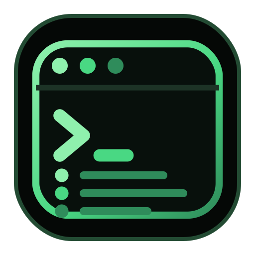
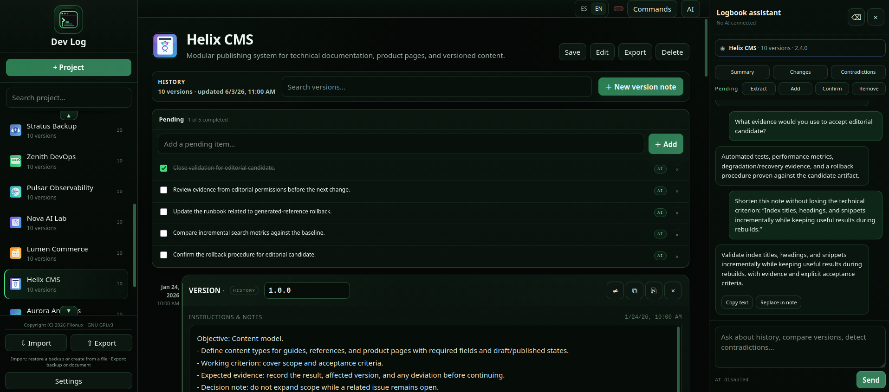

<a href="assets/icons/icon.png"></a>

# Dev Log - Bitácora Dev

**English** · [Español](README_es.md)

   

A logbook for projects that change over time: it saves what you did and why, not just the final state. It runs in the browser, works locally and AI is optional.

Current version: **3.2.2**

🎬 [Watch the demo](assets/demo/demo.mp4)

https://github.com/user-attachments/assets/1a1ea373-bc86-4983-ab29-dd277ee62225

🎬 [Watch the AI demo](assets/demo/demo-AI.mp4): an artificial intelligence using the program, which in turn is connected to low-resource local models.

https://github.com/user-attachments/assets/1480ff3f-7424-4d92-b5e4-ee5f292d4fb8

## What's new in 3.2.2

**New**

- **Save** (`Ctrl + S` / `Cmd + S`, also in the **Commands** palette). It works with autosave off, and a pending save is also written when the tab is closed or hidden.
- **Backup** downloads the whole database as JSON, without your API keys; with encryption turned on in **Settings**, it comes out password-protected. **Import** restores it (an encrypted backup asks for its password), keeps the API keys already stored in the browser and offers **Undo**.
- **APIs backup and optional encryption** (**Settings**): **Export APIs** and **Import APIs** carry the AI provider configuration, keys included, apart from the logbook. Two checkboxes protect that file and the **Backup** with a password (AES-256, minimum 8 characters); without the password there is no way to open them.
- **Help** button with a built-in tutorial in Spanish and English.
- **Per-fragment text format:** font (Sans, Serif or Mono), size, bold, italic, underline and strikethrough on any selected piece of text (or on what you type next). The text itself stays plain text. Text areas also resize smoothly as you type or paste.
- **Renumber versions** (AI panel): the assistant proposes a new numbering and nothing changes until you press **Accept**. Reverts are kept and the change can be undone; **Another scheme** asks for a different proposal. Quick schemes and pairs such as "1.2 => 2.0" are computed locally, without AI.
- **The assistant operates the app** (AI panel): on request, it does what the interface does —export, backups, projects, notes and their formatting, analysis, search, pending tasks, undo, renumbering, settings...— and leaves the result in view. Deleting, replacing text, turning the AI off, renumbering and exporting the APIs unencrypted ask first.
- **Assistant memory:** **Import memory** and **Export memory** in the panel header, for this project or for all of them.
- **Model profile** (**Settings**): with small models (up to ≈ 5B) the assistant sends short, single-task requests; **Automatic** decides from the size in the model name, and **Compact** or **Full** set it by hand.
- **`window.BitacoraAPI`:** 49 operations for agents and scripts, listed by `BitacoraAPI.describe()`. Every control carries a stable `data-agent` attribute and a unique `aria-label`.
- Quick-scroll arrows (▲ ▼) in the notes area.
- Subtle terminal-style animations, switched off when the system asks for reduced motion (`prefers-reduced-motion`).
- **Long histories in batches** (AI panel): when the history doesn't fit in one request, it is sent in consecutive, balanced batches cut between versions. Each batch receives the findings of the previous one, every result appears in the chat as it finishes (`Batch 1 of 3 · 1.0 → 1.26`) and only the final answer updates the pending tasks. Before, the oldest versions were dropped.

**Changed**

- The sidebar footer groups **Save**, **Backup**, **Export** and **Import**, each with its own shade of green and shape.
- Note actions (softer colors): **Analyze changes**, **Duplicate** and **Delete** at the top; **Copy text** replaces **Save** at the bottom.
- **Export** no longer offers JSON: JSON is now the **Backup**.
- The **Commands** and **AI** buttons stand out more, and the notes scrollbar is thicker.
- The panel that appears when you select text is compact, dark green, and no longer covers the note's format bar.
- New app icon (stacked versions with a prompt) and a more symbolic favicon that fills the whole tab icon; the browser tab shows only “Dev Log”. Project icons are larger: 29 px in the list (was 25) and 68 px in the notes header (was 52); new icons are stored at 192 px (was 128).

**Fixed**

- A red badge was always visible next to **Commands**. The **Memory only** warning now appears only when the browser blocks local storage.
- The HTML file now starts with `<!DOCTYPE html>` (uppercase, as Scriptya requires), followed by the Scriptya metadata (`MENU`, `DESCRIPTION`, `CONFIRM`, `ORDER`, `ICON`); the license comment used to come first.
- **Analyze changes** opens an already saved analysis even when no AI provider is active. A provider is now required only to generate a new analysis.

---

## What it is

Most tools save a project's current state; Bitácora Dev also saves the path that led there. It organizes work into **projects, versions, instructions and notes, decisions, pending tasks and AI conversations**.

Each project has its own history: every meaningful piece of progress is recorded as a version, and each version can explain what was done, why it was done, what happened afterwards and what remained pending. In a software project, for example, a version doesn't have to be just `v1.2` — it can be the note that explains why a library was dropped, what alternative was tried and what's left to resolve. The goal isn't to create lots of versions just because you can; it's to make sure the ones that do exist make sense.

Although the name is aimed at software, the structure also fits an essay, research, academic work, documentation, design or any project where changes and decisions matter.



When a project grows, remembering its current state is easy; the hard part is remembering **why it got there**.

## Advantages

- **Per-project history.** Each project brings together its versions, notes, pending work and conversation.
- **Readable at a glance.** The version tree separates a project's stages (`1.0`, `2.0`, `3.0`) from the work inside each one (`1.1`, `1.2`...).
- **Reverts without deleting history.** A version can state that it reverts another, and both remain part of the history.
- **Optional, contextual AI.** It works from the recorded history — summarizing, comparing versions, detecting contradictions, managing pending work and rewriting text — with local or cloud providers. Without AI, history, editors, search, reverts and project management keep working.
- **Local-first.** The core application doesn't depend on its own backend: projects live in the browser, and a JSON backup is one click away.
- **A single file.** No build, no installation and no dependencies to manage: open `script/bitacora-dev.html`.
- **Imports and exports what you already have.** JSON, TXT, Markdown, DOCX and PDF in; TXT, DOCX and PDF out.
- **Bilingual.** Spanish and English, interface and assistant.
- **Agent-ready.** `window.BitacoraAPI` lets a script or an agent do everything the interface does.

## Installation and compatibility

### Installation

There's no traditional build or installation step. Download or clone the repository and open `script/bitacora-dev.html` in a modern browser.

To get started:

1. Click **+ Project**.
2. Add a name, a description and, if you want, an icon.
3. Write in the **INSTRUCTIONS & NOTES** of version 1.0, which the project already has, what you're doing and why.
4. Create new versions when there's meaningful progress or a decision worth preserving — avoid creating one for every tiny edit.

Want to try it with data already loaded first? `assets/demo/` includes the same demo in Spanish and in English (`bitacora-dev-demo-es.json` and `bitacora-dev-demo-en.json`), ready to import: software projects and projects from other fields (thesis, novel, music, engineering...) with their versions, conversations and tasks, built to show off long histories, the version tree, reverts, rewriting and AI analysis. The first project is a user guide: every note is a chapter and the pending items are the route to practice. Import it like any other file: **Import** → pick the file. As with any JSON backup, importing replaces all your projects, so make a **Backup** first.

### Compatibility

- **Environment:** modern browser with JavaScript enabled. The automated tests run on Chromium, and the layout is checked from 320 px to 1920 px wide, so it also fits a phone.
- **Local core:** projects, versions, notes, search, pending work, reverts and storage are managed in the browser.
- **AI:** local and cloud providers configured from **Settings**.
- **Documents:** TXT and DOCX export work offline. Exporting to PDF and importing DOCX or PDF load a library from the jsDelivr CDN (PDF export falls back to unpkg if jsDelivr fails), so they need a connection.
- **Cloud providers:** requests leave the browser directly and may depend on CORS and the provider's policies.

### Works well with Scriptya

[Scriptya](https://github.com/filonux/Scriptya) is another project by Filonux: a menu that organizes your scripts into folders, runs them with fuzzy search, and can turn any of them —bitacora-dev included— into a standalone app with its own icon, in the applications menu or on the desktop, without having to write a `.desktop` file by hand.

You can point it at this repository's `script/` folder and launch Bitácora Dev from there, or use `scriptya --icons` to install it as a separate app. Scriptya also reads optional metadata at the top of each script (menu name, description, whether it asks for confirmation, whether it needs `sudo`...); `bitacora-dev.html` already includes `MENU`, `DESCRIPTION`, `CONFIRM`, `ORDER` and `ICON`, so Scriptya lists it with its name, description and icon.

## How it works

### The interface

The screen has four areas:

- The **sidebar** holds the program identity, project search and creation, the project list (most recently updated first, each with its icon) and, at the bottom, **Save**, **Backup**, **Export**, **Import** and **Settings**.
- The **top bar** has the language switch and the **Help**, **Commands** and **AI** buttons.
- The **main area** manages the selected project: its header offers **Edit** (name, description and icon), **Export** and **Delete**, and the HISTORY block shows the version count, last update date, history search and the button to create a new note — one at the top and one at the end, so a long history never forces a long scroll.
- The **AI panel**, on the right, is contextual to the open project; on narrow screens it opens as a layer over the notes.

When there is more content above or below, small ▲ ▼ arrows appear in the project list and in the notes area to scroll quickly.

### Projects and versions

A project is the logbook itself —name, description, icon, history, conversation and pending tasks—, and versions are the entries it accumulates over time. Each version keeps its number, its **INSTRUCTIONS & NOTES**, its dates and, when relevant, a revert. The tree view separates a project's major milestones (`1.0`, `2.0`, `3.0`) from the incremental work inside each one (`1.1`, `1.2`...) at a glance, supports formats like `1`, `1.0`, `1.1` or `v4.1`, and doesn't impose any strict rule about what counts as a root — that choice is still yours:

```text
1.0
    1.1
    1.2
    1.3

2.0
    2.1
    2.2
```

Project search also finds version content; history search locates text inside instructions and notes.

A version can be duplicated at any point: the app copies its instructions and notes into a new entry appended at the end of the history, with the next number suggested automatically from the project's current latest version — for example, while `2.1` is the latest version, duplicating it (or any earlier version) suggests `2.2`.

### Notes, reverts and pending work

**INSTRUCTIONS & NOTES** isn't limited to technical instructions — it can hold what had to be done, what was decided, what was observed, what problem appeared, what solution was adopted, and what remains pending, so you can open a version months later and still understand what was happening.

Each note keeps its actions close: at the top, **Analyze changes**, **Duplicate** and **Delete**; at the bottom, **Copy text** (puts the version number and the instructions on the clipboard), **Export** and **Select note**.

The format bar above the text changes the **font** (Sans, Serif or Mono) and the **font size**, and applies **bold**, **italic**, **underline** and **strikethrough** to the text you have selected — or, with no selection, to what you type next. `Ctrl/Cmd+B`, `I` and `U` toggle bold, italic and underline, and `Ctrl/Cmd+Z` undoes format changes too. A note can mix as many styles as you like.

The format is stored as ranges next to the note (`marks`) — it survives a reload, a backup and a re-import — but the text itself stays plain text, so search, export, AI context and rewriting are unchanged.

When a decision is undone, there's no need to erase the history: each version has a **Reverts** field listing every earlier version in the project, so recording a revert takes one click and the relationship stays on record (the AI can use it as context too):

```text
2.1  →  new architecture
2.2  →  reverts 2.1
```

**Pending tasks** keep future work separate from the historical record. Add one directly from the field at the top of the list, or let AI populate them: **Extract** reads the history and adds each task it finds — duplicates already on the list are skipped automatically.

You can also ask the assistant, directly or with **Add**, **Confirm** and **Remove**, to add, edit, complete (or reopen), move (“move pending 2 to first”) or remove a task: in the chat they appear numbered as in the list. However it arrives, each task can remain open, be marked complete or be removed, and AI-sourced ones carry a small tag so you can tell them apart from ones you typed yourself.

### AI assistant

The contextual panel offers quick actions that send their request right away: **Summary** (state, objective, latest version and visible risks), **Changes** (compares the three most recent versions) and **Contradictions** (incompatible instructions, contradictory decisions, possible reversions). The pending row adds **Extract** (reads the history and adds the tasks that are missing), **Add** (leaves “Add a pending item:” in the chat box for you to complete) and **Confirm** and **Remove** (list the open pending items in the chat: tick the ones you want and press **Apply**; they need no model).

You can also ask directly, for example "what changed between 2.1 and 2.2?" or "what's still pending?". The assistant distinguishes recorded facts from inference, doesn't invent information that isn't in the history, and if you ask it for code that isn't already recorded in a version, it explains that its job is to query and organize the project's history, not generate new code.

If the history doesn't fit the provider's context window, it sends it in consecutive batches, shows each result as it finishes and gives a final answer over all versions.

**Analyze changes** compares two versions and, with an active AI provider, returns a semantic explanation — not just a text diff — with a summary, the relevant changes, impact or risks, and a conclusion, always starting with a clear state: **CHANGES DETECTED**, **NO CHANGES**, **NO RELATION** or **INCONCLUSIVE RESULT**. The analysis can be kept as a comment on the version, regenerated (**Reanalyze**), or stepped through with **Previous** / **Latest** controls if you do that more than once; editing a version's notes afterward automatically clears the stored analysis, so a saved comment never quietly goes stale. Without AI, the application doesn't pretend a shallow diff is semantic analysis.

**Rewrite** lets you select part of a note and ask for a style — professional, reflective, technical, concise or suggestion (the Spanish interface also offers an English translation) — then copy, apply, discard the result, or refine it with a follow-up instruction before applying.

**Renumber versions** (a button in the AI panel) asks the assistant to review the project's numbering and propose a new one that fits its pace; with **Another scheme** you can ask again and state the scheme you prefer — "semantic", "integers only", "year.month". The proposal appears in the chat and nothing changes until you press **Accept**: it then renames every version, keeps the **Reverts** relationships, can be undone, and expires if you edit the versions by hand before accepting. If the current numbering already fits, there is nothing to apply.

The chat's **quick schemes** —`1.0.0`, integers only, `year.month` and `major.minor`— and **written pairs** (`1.2 => 2.0; #3 -> 3.1`, by number, name or position) are computed locally: they don't call the AI, work without a provider and give the same notice, with **Accept** and **Undo**. `year.month` uses each note's date; the semantic scheme and `major.minor` raise only the minor number, one step at a time, so to decide which version is "major" write a pair or use **Another scheme** with the AI. A question such as "If I do 1.2 -> 2.0, what changes?" still goes to the AI; if the plan is impossible (a repeated number or a version with two numbers), the chat gives the specific reason and doesn't call it either.

**The assistant operates the app.** Ask for anything the interface does —export a project or note to TXT, DOCX or PDF, make a backup, save, import, create a project or a note, select a note, analyze its changes, search, manage the pending tasks, undo, copy a note, renumber with a scheme, export or import the APIs, turn encryption on or off, format a note or a fragment of it, change the version number of a note, duplicate it, switch language, zoom, autosave, model profile or AI provider, open Help or Settings— and the assistant runs it with an `[[ACTION: …]]` marker instead of pasting the content into the chat.

Clear one-line commands (“export the project to txt”, “make a backup”, “switch to English”, “export the memory”, “change version 2.0.0 to 1.0.0”, “make it bold, size 16”, “export the APIs encrypted”, “undo”) run locally, without calling the model; a missing format, an ambiguous target (an unquoted fragment, a note without a number) or a question is left to the model. Each action leaves a terminal-style card with its result (`✓` or `✗`), and the note or list it touches is brought into view. Deleting a project or note, replacing the text of a note, turning the AI off, renumbering, deleting all analyses, exporting the APIs as plain text and turning an encryption off ask for confirmation, and import asks you to pick the file.

The assistant does not need your API keys or passwords: they are typed into the app's own dialog (an `[[ACTION: …]]` marker does not read them) and the result of an action is not sent back to the model. If you type one in the chat anyway, it is replaced by “••••••” before the message is saved or sent, but only when it is in quotes, follows “=” or looks like a key (6 or more characters with a digit, a symbol or an inner capital): a plain one-word password without quotes or “=”, as in “the password is hello”, is not detected, so do not type it in the chat. Deliberately without an action: the project icon (it needs an image) and rewriting a selection (a gesture on the chosen text that calls the AI).

**Assistant memory.** The panel header has **Import memory** and **Export memory**, to the left of **Clear chat**. They save or restore the assistant chat of this project or of all projects as a JSON with only the id, name and chat (no notes, no API keys). Import matches projects by id and, failing that, by name; it never creates projects, and if the destination chat already has messages it asks whether to **Replace** or **Add**.

Without a connected provider, this section is disabled and says so explicitly; the rest of the application keeps working the same.

### Saving, backups, import and export

**Save** stores every project's changes in this browser (`localStorage`). Shortcut: `Ctrl + S` / `Cmd + S`; it is also in the **Commands** palette. It works even when autosave is off.

**Autosave** saves a moment after each change: it is on by default, with a configurable interval (250 ms, 500 ms, 1 s or 2 s), or can be switched off in **Settings**; a pending save is also flushed when the tab is closed or hidden.

**Backup** downloads a JSON with the whole database — projects, versions and settings — **without your API keys** (with the optional encryption in **Settings** it comes out password-protected). It is the real save: make one before clearing the browser or changing computers, and restore it with **Import**. If the browser blocks local storage, the app shows the **Memory only** warning: changes last only for that tab, so make a backup.

**Import** restores a backup (`.json`) or creates a new project from a TXT, Markdown, DOCX or PDF file (it extracts the text). Restoring a JSON replaces the whole database, keeps the API keys already stored in the browser, and offers **Undo**. An encrypted backup asks for its password.

**Export** (sidebar) creates a single TXT, DOCX or PDF document with every project. For one project or one note, use **Export** inside them. JSON doesn't come out of **Export**: it is the **Backup**, the only format **Import** fully restores.

### Settings

**Language.** The interface works in Spanish and English and affects controls, messages, quick actions and the AI tools — including the app's own name, which appears as "Dev Log" in English. The assistant always answers in whichever interface language you've selected, regardless of the language used in the notes.

**AI providers.** From **Settings** you can choose between LM Studio, Ollama, OpenAI, Anthropic, OpenRouter, xAI/Grok, Groq, Google Gemini, DeepSeek, Mistral AI or Together AI, configure the base URL, model and key, detect models and test the connection. Calling Anthropic's API directly from the browser requires enabling its CORS-compatible direct-browser-access mode; LM Studio and Ollama typically just need CORS enabled on the local server. Keys are stored in the browser profile.

**Model profile.** With small models (up to ≈ 5B) the assistant sends short, single-task requests: the program picks the context, decides the action and reads the answer, and the model only writes the text. **Automatic** decides from the size in the model name (5B or less, compact; no recognizable size, full); **Compact** and **Full** set it by hand, and **Full** sends the usual requests. In compact, **Analyze changes** sends only the removed and added sentences, and two identical notes do not call the model.

**Saving.** Autosave and its interval are set here; everything else is in [Saving, backups, import and export](#saving-backups-import-and-export).

**APIs backup.** **Export APIs** and **Import APIs** save and restore only the AI provider configuration —URLs, models and keys—, separately from the logbook: the **Backup** never carries your keys. Importing overwrites the providers the file lists and the active provider; an empty key never erases a saved one. Without encryption the file holds your keys as plain text.

**Encryption (optional).** Two checkboxes in **Settings** protect the files with a password (AES-256-GCM, key derived with PBKDF2-SHA-256 at 600,000 iterations, minimum 8 characters):

- *Encrypt the file with a password* (APIs): every export asks for a password, with confirmation, and stores it nowhere.
- *Encrypt the backup with a password*: the password is kept in this browser, like the API keys, and backups come out encrypted without asking; **Change password** renews it and unchecking the box deletes it.

When you import an encrypted file the app detects it and asks for the password; importing an encrypted backup keeps its password for the next ones. **Without the password there is no way to open the file**: write it down somewhere safe. Without Web Crypto (an insecure context) encryption is unavailable.

**Version and license.** Settings shows the app version (`v3.2.2`) and the license notice, right below the active provider.

### Help and commands

The **Help** button opens a built-in tutorial, in Spanish and English, that explains the buttons, saving and features (`Esc` closes it).

The **Commands** palette (`Ctrl + K` / `Cmd + K`) lets you, without the mouse: create a project, create a version, open the assistant, open **Settings**, export the project, save changes, make a backup or open the help.

### Agents and automation

Everything the interface does can also be done by an agent — or a script from the browser console — through `window.BitacoraAPI`, a frozen object with 49 operations. `BitacoraAPI.describe()` lists them with their arguments.

- Every operation returns `{ ok: true, data }` or `{ ok: false, error: { code, message } }`, and none opens dialogs. Descriptions and error messages are always in English; `error.code` is stable.
- `deleteProject`, `deleteVersion`, `importDatabase` and `importApis` require `confirm: true`, and so does `importMemory` when it would replace a chat that already has messages; without it they return the `confirm-required` error.
- Encryption: `setApiEncryption` and `setBackupEncryption` turn the two options on or off. With the backup option on, `backup` returns the file encrypted with the password saved in the browser (no operation returns it); `exportApis` encrypts with the `password` it receives (not stored), and `importDatabase` and `importApis` accept it to open encrypted files.
- `proposeRenumber` is asynchronous and leaves the proposal in the chat; `acceptRenumber` applies it by `messageId`. With `scheme` (`semver`, `int`, `minor` or `calver`) and no text, the proposal is computed locally.
- `renumberVersions` renumbers without AI using `scheme` or `map`: keys are an id, the current number (`"1.2"`) or a position (`"#3"`), and values are strings (`"2.0"`). If anything fails, the error says how to fix it and nothing changes.
- `addVersion` and `setText` accept `marks` (`[{ from, to, b?, i?, u?, s?, font?, size? }]`, in characters) and `style` (formatting for the whole note): a complete formatted note is written in one call. With `setText` they replace the previous formatting and are not allowed with `append`; if anything is invalid, the note is untouched.
- The operations that use the AI (`analyzeChanges`, `askAI`, `rewriteText`) are asynchronous and return `ai-not-configured` when no provider is active; `rewriteText` only proposes, and `applyRewrite` applies the proposal by `messageId`.
- Interface controls carry `data-agent` (plus `data-target` when several are alike) and a unique `aria-label`, in Spanish and English.

```js
const api = window.BitacoraAPI;
const { data: project } = api.createProject({ name: 'My project' });   // creates version 1.0
api.addVersion({ projectId: project.id, instructions: 'First note' });
const { data: backup } = await api.backup();                            // { filename, json, encrypted }, no API keys
api.deleteProject({ id: project.id, confirm: true });
```

### Privacy

Bitácora Dev is local-first: the main history lives in the browser and doesn't require an application backend. Connecting a cloud AI provider does send requests out of the browser to that provider — review its terms before sending sensitive information. For a fully local workflow, use LM Studio or Ollama.

## Contributing

Issues and pull requests are welcome — there are templates in `.github/` for reporting bugs or proposing features. The complete guide is in [.github/CONTRIBUTING.md](.github/CONTRIBUTING.md), and the project follows its [Code of Conduct](.github/CODE_OF_CONDUCT.md). For security problems, see the [Security Policy](.github/SECURITY.md).

The application is a single file, `script/bitacora-dev.html`, and every change comes with its end-to-end tests (Playwright on Chromium) in `tests/`:

```text
npm i --prefix .. --no-save playwright@1.56.0
npx --prefix .. playwright install chromium
node --test --test-concurrency=2 tests/*.test.mjs
```

Playwright goes in the folder above the repository (Node finds it from there), so the repository itself never gets a `node_modules` folder. The same suite runs through GitHub Actions (`.github/workflows/tests.yml`) on every push and pull request that touches `script/`, `tests/` or the workflow itself.

## License

Bitácora Dev is released under the **GNU General Public License v3.0 (GPLv3)**, with the full text in the [LICENSE.txt](LICENSE.txt) file (also noted in **Settings**).

© 2026 Filonux.

---

Made by **[Filonux](https://github.com/filonux)**.
