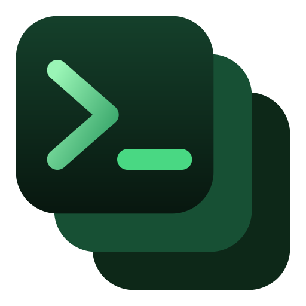
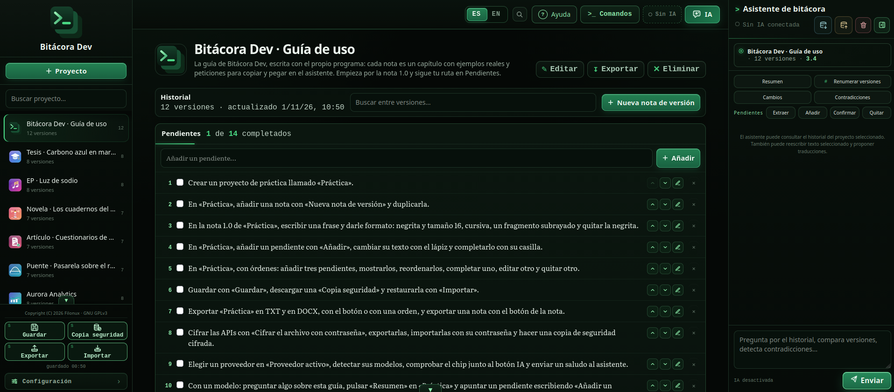

<a href="assets/icons/icon.png"></a>

# Bitácora Dev

**Español** · [English](README.md)

   

Un cuaderno de bitácora para proyectos que cambian con el tiempo: guarda qué hiciste y por qué, no solo el estado final. Funciona en el navegador, está pensado para trabajar en local y la IA es opcional.

Versión actual: **3.2.2**

🎬 [Ver la demo](assets/demo/demo.mp4)

https://github.com/user-attachments/assets/84a9c954-9cde-4381-9c12-331aa0f140e0

🎬 [Ver la demo con IA](assets/demo/demo-AI.mp4): una inteligencia artificial utilizando el programa, que a su vez está conectado con modelos locales de bajos recursos.

## Novedades de la 3.2.2

**Nuevo**

- **Guardar** (`Ctrl + S` / `Cmd + S`, también en la paleta de **Comandos**). Funciona con el autoguardado desactivado, y un guardado pendiente también se escribe al cerrar u ocultar la pestaña.
- **Copia seguridad** descarga toda la base de datos en JSON, sin tus claves de API; con el cifrado activado en **Configuración**, sale protegida con contraseña. **Importar** la restaura (una copia cifrada pide su contraseña), conserva las claves de API ya guardadas en el navegador y ofrece **Deshacer**.
- **Copia de las APIs y cifrado opcional** (**Configuración**): **Exportar APIs** e **Importar APIs** llevan la configuración de los proveedores de IA, claves incluidas, aparte de la bitácora. Dos casillas protegen con contraseña (AES-256, mínimo 8 caracteres) ese archivo y la **Copia seguridad**; sin la contraseña no hay forma de abrirlos.
- Botón **Ayuda** con un tutorial integrado en español e inglés.
- **Formato de texto por fragmento:** fuente (Sans, Serif o Mono), tamaño, negrita, cursiva, subrayado y tachado sobre cualquier trozo de texto seleccionado (o sobre lo que escribas a continuación). El texto sigue siendo texto plano. Además, las áreas de texto se redimensionan con fluidez al escribir o pegar.
- **Renumerar versiones** (panel de IA): el asistente propone una numeración nueva y no cambia nada hasta que pulsas **Aceptar**. Se conservan las reversiones y el cambio puede deshacerse; **Otro esquema** pide una propuesta distinta. Los esquemas rápidos y los pares como «1.2 => 2.0» se calculan en local, sin IA.
- **El asistente maneja el programa** (panel de IA): ejecuta al pedirlo lo que hace la interfaz —exportar, copias, proyectos, notas y su formato, análisis, búsqueda, pendientes, deshacer, renumerar, ajustes...— y deja el resultado a la vista. Borrar, reemplazar texto, quitar la IA, renumerar y exportar las APIs sin cifrar piden confirmación.
- **Memoria del asistente:** botones **Importar memoria** y **Exportar memoria** en la cabecera del panel, para este proyecto o para todos.
- **Perfil del modelo** (**Configuración**): con modelos pequeños (hasta ≈ 5B) el asistente manda peticiones cortas, de una sola tarea; **Automático** lo decide por el tamaño que indica el nombre del modelo, y **Compacto** o **Completo** lo fijan a mano.
- **`window.BitacoraAPI`:** 49 operaciones para agentes y scripts, que lista `BitacoraAPI.describe()`. Cada control lleva un atributo `data-agent` estable y un `aria-label` único.
- Flechas de desplazamiento rápido (▲ ▼) en la zona de notas.
- Animaciones sutiles estilo terminal, desactivadas cuando el sistema pide reducir el movimiento (`prefers-reduced-motion`).
- **Historiales largos por tandas** (panel de IA): cuando el historial no cabe en una petición, se envía en tandas consecutivas y equilibradas, cortadas entre versiones. Cada tanda recibe los hallazgos de la anterior, cada resultado aparece en el chat según termina (`Tanda 1 de 3 · 1.0 → 1.26`) y solo la respuesta final actualiza las tareas pendientes. Antes se descartaban las versiones más antiguas.

**Cambiado**

- El pie de la barra lateral reúne **Guardar**, **Copia seguridad**, **Exportar** e **Importar**, cada uno con su propia tonalidad de verde y su propia forma.
- Acciones de nota (con colores más suaves): **Analizar cambios**, **Duplicar** y **Eliminar** arriba; **Copiar texto** sustituye a **Guardar** abajo.
- **Exportar** ya no ofrece JSON: el JSON es ahora la **Copia seguridad**.
- Los botones **Comandos** e **IA** tienen más presencia y la barra de desplazamiento de las notas es más gruesa.
- El panel que aparece al seleccionar texto es compacto, de verde oscuro, y ya no tapa la barra de formato de la nota.
- Icono nuevo de la app (capas de versiones con un prompt) y favicon más simbólico que ocupa todo el espacio; la pestaña del navegador muestra solo «Bitácora Dev». Los iconos de proyecto son mayores: 29 px en la lista (antes 25) y 68 px en la cabecera de notas (antes 52); los iconos nuevos se guardan a 192 px (antes 128).

**Corregido**

- Un distintivo rojo estaba siempre visible junto a **Comandos**. El aviso **Solo en memoria** aparece ahora únicamente cuando el navegador bloquea el almacenamiento local.
- El archivo HTML empieza ahora por `<!DOCTYPE html>` (en mayúsculas, como exige Scriptya) y le siguen los metadatos de Scriptya (`MENU`, `DESCRIPTION`, `CONFIRM`, `ORDER`, `ICON`); antes iba primero el comentario de licencia.
- **Analizar cambios** abre un análisis ya guardado aunque no haya ningún proveedor de IA activo. Solo se exige un proveedor para generar un análisis nuevo.

---

## Qué es

La mayoría de las herramientas guardan el estado actual de un proyecto; Bitácora Dev guarda además el camino recorrido para llegar hasta ahí. Organiza el trabajo en **proyectos, versiones, instrucciones y notas, decisiones, tareas pendientes y conversaciones con IA**.

Cada proyecto tiene su propia historia: cada avance significativo se registra como una versión, y cada versión puede explicar qué se hizo, por qué se hizo, qué ocurrió después y qué quedó pendiente. Por ejemplo, en un proyecto de software una versión no tiene por qué ser solo `v1.2`: puede ser la nota que explica por qué se abandonó una librería, qué alternativa se probó y qué queda por resolver. El objetivo no es crear muchas versiones porque sí, sino que las que existen tengan sentido.

Aunque el nombre está pensado para software, la estructura también encaja con un ensayo, una investigación, un trabajo académico, documentación, diseño o cualquier proyecto donde los cambios y las decisiones importen.



Cuando un proyecto crece, recordar su estado actual es fácil; lo difícil es recordar **por qué llegó ahí**.

## Ventajas

- **Historial por proyecto.** Cada proyecto reúne sus versiones, notas, tareas pendientes y conversación.
- **Se lee de un vistazo.** El árbol de versiones separa las etapas del proyecto (`1.0`, `2.0`, `3.0`) del trabajo dentro de cada una (`1.1`, `1.2`...).
- **Reversiones sin borrar el historial.** Una versión puede indicar que revierte otra, y ambas siguen formando parte de la historia.
- **IA opcional y contextual.** Trabaja a partir del historial registrado — resume, compara versiones, detecta contradicciones, gestiona tareas pendientes y reescribe texto — con proveedores locales o en la nube. Sin IA, el historial, los editores, la búsqueda, las reversiones y la gestión de proyectos siguen funcionando.
- **Local-first.** El núcleo de la aplicación no depende de un backend propio: los proyectos viven en el navegador, y una copia de seguridad en JSON está a un clic.
- **Un solo archivo.** Sin compilación, sin instalación y sin dependencias que gestionar: abre `script/bitacora-dev.html`.
- **Importa y exporta lo que ya tienes.** JSON, TXT, Markdown, DOCX y PDF de entrada; TXT, DOCX y PDF de salida.
- **Bilingüe.** Español e inglés, tanto la interfaz como el asistente.
- **Listo para agentes.** `window.BitacoraAPI` permite hacer desde un script o un agente todo lo que hace la interfaz.

## Instalación y compatibilidad

### Instalación

No hay compilación ni instalación tradicional. Descarga o clona el repositorio y abre `script/bitacora-dev.html` en un navegador moderno.

Para empezar:

1. Haz clic en **+ Proyecto**.
2. Añade un nombre, una descripción y, si quieres, un icono.
3. Escribe en **INSTRUCCIONES Y NOTAS** de la versión 1.0, que el proyecto ya trae, qué estás haciendo y por qué.
4. Crea nuevas versiones cuando haya un avance significativo o una decisión que merezca conservarse — evita crear una por cada edición mínima.

¿Prefieres probar antes con datos ya cargados? `assets/demo/` incluye la misma demo en español y en inglés (`bitacora-dev-demo-es.json` y `bitacora-dev-demo-en.json`), lista para importar: proyectos de software y de otras disciplinas (tesis, novela, música, ingeniería...) con sus versiones, conversaciones y tareas, pensados para mostrar historiales largos, el árbol de versiones, las reversiones, la reescritura y el análisis con IA. El primer proyecto es una guía de uso: cada nota es un capítulo y los pendientes, la ruta para practicar. Se importa igual que cualquier archivo: **Importar** → elige el archivo. Como al restaurar cualquier JSON, se sustituyen todos tus proyectos: haz antes una **Copia seguridad**.

### Compatibilidad

- **Entorno:** navegador moderno con JavaScript activado. Los tests automáticos se ejecutan en Chromium, y el diseño se comprueba desde 320 px hasta 1920 px de ancho, así que también encaja en un móvil.
- **Núcleo local:** proyectos, versiones, notas, búsqueda, tareas pendientes, reversiones y almacenamiento se gestionan en el navegador.
- **IA:** proveedores locales y en la nube configurados desde **Configuración**.
- **Documentos:** exportar a TXT y a DOCX funciona sin conexión. Exportar a PDF e importar DOCX o PDF cargan una librería desde el CDN jsDelivr (la exportación a PDF recurre a unpkg si jsDelivr falla) y necesitan conexión.
- **Proveedores en la nube:** las peticiones salen del navegador directamente y pueden depender de CORS y de las políticas del proveedor.

### Se lleva bien con Scriptya

[Scriptya](https://github.com/filonux/Scriptya) es otro proyecto de Filonux: un menú que organiza tus scripts en carpetas, los ejecuta con búsqueda difusa y puede convertir cualquiera de ellos —bitacora-dev incluido— en una app independiente con su propio icono, en el menú de aplicaciones o en el escritorio, sin tener que escribir un `.desktop` a mano.

Le puedes apuntar a la carpeta `script/` de este repositorio y lanzar Bitácora Dev desde ahí, o usar `scriptya --icons` para dejarlo instalado como app aparte. Scriptya también lee metadatos opcionales al principio de cada script (nombre para el menú, descripción, si pide confirmación, si necesita `sudo`...); `bitacora-dev.html` ya incluye `MENU`, `DESCRIPTION`, `CONFIRM`, `ORDER` e `ICON`, así que Scriptya lo muestra con su nombre, descripción e icono.

## Cómo funciona

### La interfaz

La pantalla se organiza en cuatro zonas:

- La **barra lateral** reúne la identidad del programa, la búsqueda y creación de proyectos, la lista de proyectos (el más reciente primero, cada uno con su icono) y, abajo, **Guardar**, **Copia seguridad**, **Exportar**, **Importar** y **Configuración**.
- La **barra superior** tiene el selector de idioma y los botones **Ayuda**, **Comandos** e **IA**.
- El **área principal** gestiona el proyecto seleccionado: su cabecera ofrece **Editar** (nombre, descripción e icono), **Exportar** y **Eliminar**, y el bloque HISTORIAL muestra el número de versiones, la fecha de la última actualización, la búsqueda del historial y el botón para crear una nueva nota — hay uno arriba y otro al final, para que un historial largo no obligue a hacer scroll.
- El **panel de IA**, a la derecha, es contextual al proyecto abierto; en pantallas estrechas se abre como una capa sobre las notas.

Cuando hay más contenido por encima o por debajo, aparecen pequeñas flechas ▲ ▼ en la lista de proyectos y en la zona de notas para desplazarte con rapidez.

### Proyectos y versiones

Un proyecto es el cuaderno en sí —nombre, descripción, icono, historial, conversación y tareas pendientes—, y las versiones son las entradas que va acumulando con el tiempo. Cada versión guarda su número, sus **INSTRUCCIONES Y NOTAS**, sus fechas y, si aplica, una reversión. La vista en árbol separa de un vistazo los grandes hitos (`1.0`, `2.0`, `3.0`) del trabajo incremental dentro de cada uno (`1.1`, `1.2`...), admite formatos como `1`, `1.0`, `1.1` o `v4.1`, y no impone ninguna regla estricta sobre qué cuenta como raíz — esa decisión es tuya:

```text
1.0
    1.1
    1.2
    1.3

2.0
    2.1
    2.2
```

La búsqueda de proyectos también encuentra contenido de las versiones; la del historial localiza texto dentro de instrucciones y notas.

Una versión puede duplicarse en cualquier momento: la app copia sus instrucciones y notas en una nueva entrada añadida al final del historial, con el siguiente número sugerido automáticamente a partir de la última versión actual del proyecto — por ejemplo, mientras `2.1` sea la última versión, duplicarla (o duplicar una versión anterior) sugiere `2.2`.

### Notas, reversiones y tareas pendientes

**INSTRUCCIONES Y NOTAS** no se limita a lo técnico: puede recoger qué había que hacer, qué se decidió, qué se observó, qué problema apareció, qué solución se adoptó y qué queda pendiente — la idea es poder abrir una versión meses después y seguir entendiendo qué estaba pasando.

Cada nota tiene sus acciones a mano: arriba, **Analizar cambios**, **Duplicar** y **Eliminar**; abajo, **Copiar texto** (deja el número de versión y las instrucciones en el portapapeles), **Exportar** y **Seleccionar nota**.

La barra de formato sobre el texto cambia la **fuente** (Sans, Serif o Mono) y el **tamaño de letra**, y aplica **negrita**, **cursiva**, **subrayado** y **tachado** al texto que tengas seleccionado o, sin selección, a lo que escribas a continuación. `Ctrl/Cmd+B`, `I` y `U` alternan negrita, cursiva y subrayado, y `Ctrl/Cmd+Z` también deshace los cambios de formato. Una nota puede mezclar tantos estilos como quieras.

El formato se guarda como rangos junto a la nota (`marks`) —se conserva al recargar, en la copia de seguridad y al importarla—, pero el texto sigue siendo texto plano, así que la búsqueda, la exportación, el contexto de la IA y la reescritura no cambian.

Cuando se deshace una decisión, no hace falta borrar el historial: cada versión tiene un campo **Revierte** que lista las versiones anteriores del proyecto, así que registrar una reversión es cuestión de un clic y la relación queda registrada (la IA también puede usarla como contexto):

```text
2.1  →  nueva arquitectura
2.2  →  revierte 2.1
```

Las **tareas pendientes** mantienen el trabajo futuro separado del registro histórico. Añade una directamente desde el campo situado encima de la lista, o deja que la IA las genere: **Extraer** lee el historial y añade cada tarea que encuentra — los duplicados que ya estén en la lista se descartan automáticamente.

También puedes pedirle al asistente, de forma directa o con **Añadir**, **Confirmar** y **Quitar**, que añada, edite, complete (o reabra), mueva («el pendiente 2 pasa a la primera») o elimine una tarea: en el chat salen numeradas como en la lista. Sea cual sea su origen, cada tarea puede quedar abierta, completarse o eliminarse, y las que vienen de la IA llevan una pequeña etiqueta para distinguirlas de las que escribiste tú.

### Asistente de IA

El panel contextual ofrece acciones rápidas que envían su petición al momento: **Resumen** (estado, objetivo, última versión y riesgos visibles), **Cambios** (compara las tres versiones más recientes) y **Contradicciones** (instrucciones incompatibles, decisiones contradictorias, posibles reversiones). La fila de pendientes añade **Extraer** (lee el historial y añade las tareas que falten), **Añadir** (deja «Añadir un pendiente:» en el cuadro del chat para que lo completes) y **Confirmar** y **Quitar** (listan en el chat los pendientes abiertos: marcas los que quieras y pulsas **Aplicar**; no necesitan modelo).

También puedes preguntar directamente, por ejemplo «¿qué cambió entre 2.1 y 2.2?» o «¿qué sigue pendiente?». El asistente distingue hechos registrados de inferencias, no inventa información que no esté en el historial y, si le pides código que no está ya en una versión, explica que su función es consultar y organizar la historia del proyecto, no generar código nuevo.

Si el historial no cabe en la ventana de contexto del proveedor, lo envía en tandas consecutivas, muestra cada resultado según termina y da una respuesta final sobre todas las versiones.

**Analizar cambios** compara dos versiones y, con IA activa, devuelve una explicación semántica —no un simple diff de texto— con un resumen, los cambios relevantes, el impacto o riesgos y una conclusión, empezando siempre por un estado claro: **HAY CAMBIOS**, **SIN CAMBIOS**, **SIN RELACIÓN** o **RESULTADO NO CONCLUYENTE**. El análisis puede guardarse como comentario de la versión, regenerarse (**Re-analizar**) o recorrerse con los controles **Anterior** / **Más reciente** si lo repites varias veces; editar la nota de una versión borra automáticamente el análisis guardado, para que nunca quede desactualizado sin avisar. Sin IA, la aplicación no finge que un diff superficial es un análisis semántico.

**Reescribir** deja seleccionar parte de una nota y pedir un estilo —profesional, reflexivo, técnico, conciso, tipo sugerencia o traducción al inglés (solo en la interfaz en español)—; el resultado se puede copiar, aplicar, descartar o refinar con una instrucción adicional antes de aplicarlo.

**Renumerar versiones** (botón del panel de IA) pide al asistente que revise la numeración del proyecto y proponga una nueva acorde con su ritmo; con **Otro esquema** puedes pedir otra indicando el que prefieres —«semántico», «solo enteros», «año.mes»—. La propuesta aparece en el chat y no cambia nada hasta que pulsas **Aceptar**: entonces renombra todas las versiones, conserva las relaciones **Revierte**, puede deshacerse y caduca si editas las versiones a mano antes de aceptarla. Si la numeración actual ya encaja, no hay nada que aplicar.

Los **esquemas rápidos** del chat —`1.0.0`, solo enteros, `año.mes` y `mayor.menor`— y los **pares escritos** (`1.2 => 2.0; #3 -> 3.1`, por número, nombre o posición) se calculan en local: no llaman a la IA, funcionan sin proveedor y dan el mismo aviso, con **Aceptar** y **Deshacer**. `año.mes` usa la fecha de cada nota; el esquema semántico y `mayor.menor` suben solo el número menor de uno en uno, así que, para decidir qué versión es «mayor», escribe un par o usa **Otro esquema** con la IA. Una pregunta como «Si hago 1.2 -> 2.0, ¿qué cambia?» sigue yendo a la IA; si el plan es imposible (un número repetido o una versión con dos números), el chat dice el motivo concreto y tampoco la llama.

**El asistente maneja el programa.** Pídele lo que hace la interfaz —exportar un proyecto o una nota a TXT, DOCX o PDF, hacer una copia de seguridad, guardar, importar, crear un proyecto o una nota, seleccionar una nota, analizar sus cambios, buscar, gestionar los pendientes, deshacer, copiar una nota, renumerar con un esquema, exportar o importar las APIs, activar o quitar el cifrado, dar formato a una nota o a un fragmento, cambiar el número de versión de una nota, duplicarla, cambiar idioma, zoom, autoguardado, perfil del modelo o proveedor de IA, abrir la Ayuda o Configuración— y lo ejecuta con un marcador `[[ACCION: …]]` en vez de pegar el contenido en el chat.

Las órdenes claras de una línea («exporta el proyecto a txt», «haz una copia de seguridad», «cambia a inglés», «exporta la memoria», «cambia la versión 2.0.0 a 1.0.0», «ponle negrita y tamaño 16», «exporta las APIs cifradas», «deshacer») se ejecutan en local, sin llamar al modelo; si falta el formato, el objetivo es ambiguo (un fragmento sin comillas, una nota sin número) o es una pregunta, decide el modelo. Cada acción deja una tarjeta con aspecto de terminal y su resultado (`✓` o `✗`), y la nota o la lista que toca queda a la vista. Borrar un proyecto o una nota, reemplazar el texto de una nota, quitar la IA, renumerar, borrar todos los análisis, exportar las APIs en texto plano y desactivar un cifrado piden confirmación, e importar te pide elegir el archivo.

El asistente no necesita tus claves de API ni tus contraseñas: se escriben en el diálogo del programa (un marcador `[[ACCION: …]]` no las lee) y el resultado de una acción no vuelve al modelo. Si aun así escribes una en el chat, se sustituye por «••••••» antes de guardar o enviar el mensaje, pero solo cuando va entre comillas, tras «=» o tiene aspecto de clave (6 o más caracteres con cifra, símbolo o mayúscula interior): una contraseña de una sola palabra sin comillas ni «=», como en «la contraseña es hola», no se detecta, así que no la escribas en el chat. Sin acción quedan, a propósito, el icono del proyecto (necesita una imagen) y reescribir una selección (es un gesto sobre el texto elegido y llama a la IA).

**Memoria del asistente.** La cabecera del panel tiene **Importar memoria** y **Exportar memoria**, a la izquierda de **Limpiar chat**. Guardan o recuperan el chat del asistente de este proyecto o de todos como un JSON con solo el id, el nombre y el chat (sin notas ni claves de API). Al importar, cada proyecto se empareja por id y, si no, por nombre; nunca crea proyectos, y si el chat de destino ya tiene mensajes pregunta si **Reemplazar** o **Añadir**.

Sin un proveedor conectado, esta sección se desactiva y lo indica explícitamente; el resto de la aplicación sigue funcionando igual.

### Guardado, copias de seguridad, importar y exportar

**Guardar** guarda en este navegador (`localStorage`) los cambios de todos los proyectos. Atajo: `Ctrl + S` / `Cmd + S`; también está en la paleta de **Comandos**. Funciona aunque el autoguardado esté desactivado.

El **autoguardado** guarda unos instantes después de cada cambio: viene activado, con un intervalo configurable (250 ms, 500 ms, 1 s o 2 s) o desactivable desde **Configuración**; un guardado pendiente también se vuelca al cerrar u ocultar la pestaña.

**Copia seguridad** descarga un JSON con toda la base de datos —proyectos, versiones y ajustes— **sin tus claves de API** (con el cifrado opcional de **Configuración** sale protegida con contraseña). Es el guardado auténtico: haz una antes de limpiar el navegador o cambiar de equipo, y restáurala con **Importar**. Si el navegador bloquea el almacenamiento local, la app muestra el aviso **Solo en memoria**: los cambios solo duran esa pestaña, así que haz una copia de seguridad.

**Importar** restaura una copia de seguridad (`.json`) o crea un proyecto nuevo desde un archivo TXT, Markdown, DOCX o PDF (extrae el texto). Al restaurar un JSON se sustituye toda la base de datos, se conservan las claves de API ya guardadas en el navegador y la app ofrece **Deshacer**. Una copia cifrada pide su contraseña.

**Exportar** (barra lateral) genera un único documento TXT, DOCX o PDF con todos los proyectos. Para un solo proyecto o una sola nota, usa **Exportar** dentro de ellos. El JSON no sale de **Exportar**: es la **Copia seguridad**, el único formato que **Importar** restaura por completo.

### Configuración

**Idioma.** La interfaz funciona en español e inglés y afecta a controles, mensajes, acciones rápidas y herramientas de IA —incluido el nombre de la app, que aparece como «Dev Log» en inglés—. El asistente siempre responde en el idioma de interfaz seleccionado, sin importar el idioma de las notas.

**Proveedores de IA.** Desde **Configuración** puedes elegir entre LM Studio, Ollama, OpenAI, Anthropic, OpenRouter, xAI/Grok, Groq, Google Gemini, DeepSeek, Mistral AI o Together AI, configurar URL base, modelo y clave, detectar modelos y probar la conexión. Llamar a la API de Anthropic directamente desde el navegador requiere activar su modo de acceso directo compatible con CORS; LM Studio y Ollama normalmente solo necesitan CORS activado en el servidor local. Las claves se guardan en el perfil del navegador.

**Perfil del modelo.** Con modelos pequeños (hasta ≈ 5B) el asistente manda peticiones cortas y de una sola tarea: el programa elige el contexto, decide la acción y lee la respuesta, y el modelo solo redacta. **Automático** decide por el tamaño que indica el nombre del modelo (5B o menos, compacto; sin tamaño reconocible, completo); **Compacto** y **Completo** lo fijan a mano, y **Completo** envía las peticiones de siempre. En compacto, **Analizar cambios** manda solo las frases quitadas y añadidas, y dos notas iguales no llaman al modelo.

**Guardado.** Aquí se activa o desactiva el autoguardado y se elige su intervalo; el resto está en [Guardado, copias de seguridad, importar y exportar](#guardado-copias-de-seguridad-importar-y-exportar).

**Copia de las APIs.** **Exportar APIs** e **Importar APIs** guardan y restauran solo la configuración de los proveedores de IA —URLs, modelos y claves—, por separado de la bitácora: la **Copia seguridad** nunca lleva tus claves. Al importar, el archivo sobrescribe los proveedores que lista y el proveedor activo; una clave vacía nunca borra una guardada. Sin cifrado, el archivo lleva tus claves en texto plano.

**Cifrado (opcional).** Dos casillas de **Configuración** protegen los archivos con contraseña (AES-256-GCM, clave derivada con PBKDF2-SHA-256 y 600 000 iteraciones, mínimo 8 caracteres):

- *Cifrar el archivo con contraseña* (APIs): cada exportación pide una contraseña, con confirmación, y no se guarda en ningún sitio.
- *Cifrar la copia de seguridad con contraseña*: la contraseña se guarda en este navegador, como las claves de API, y las copias salen cifradas sin preguntar; **Cambiar contraseña** la renueva y desmarcar la casilla la borra.

Al importar un archivo cifrado, el programa lo detecta y pide la contraseña; una copia cifrada importada deja su contraseña para las siguientes. **Sin la contraseña no hay forma de abrir el archivo**: anótala en un lugar seguro. Sin Web Crypto (contexto no seguro) el cifrado no está disponible.

**Versión y licencia.** Configuración muestra la versión de la app (`v3.2.2`) y el aviso de licencia, justo debajo del proveedor activo.

### Ayuda y comandos

El botón **Ayuda** abre un tutorial integrado, en español e inglés, que explica los botones, el guardado y las funciones (`Esc` lo cierra).

La paleta de **Comandos** (`Ctrl + K` / `Cmd + K`) permite, sin ratón: crear un proyecto, crear una versión, abrir el asistente, abrir **Configuración**, exportar el proyecto, guardar los cambios, hacer una copia de seguridad o abrir la ayuda.

### Agentes y automatización

Todo lo que hace la interfaz puede hacerlo un agente —o un script desde la consola del navegador— con `window.BitacoraAPI`, un objeto congelado con 49 operaciones. `BitacoraAPI.describe()` las lista con sus argumentos.

- Cada operación devuelve `{ ok: true, data }` o `{ ok: false, error: { code, message } }`, y ninguna abre diálogos. Las descripciones y los mensajes de error están siempre en inglés; `error.code` es estable.
- `deleteProject`, `deleteVersion`, `importDatabase` e `importApis` exigen `confirm: true`, y también `importMemory` si fuera a reemplazar un chat que ya tiene mensajes; sin él devuelven el error `confirm-required`.
- Cifrado: `setApiEncryption` y `setBackupEncryption` activan o quitan las dos opciones. Con la de la copia activa, `backup` devuelve el archivo cifrado con la contraseña guardada en el navegador (ninguna operación la devuelve); `exportApis` cifra con el `password` que reciba (no se guarda) y `importDatabase` e `importApis` lo aceptan para abrir archivos cifrados.
- `proposeRenumber` es asíncrona y deja la propuesta en el chat; `acceptRenumber` la aplica por `messageId`. Con `scheme` (`semver`, `int`, `minor` o `calver`) y sin texto, la propuesta se calcula en local.
- `renumberVersions` renumera sin IA con `scheme` o con `map`: claves por id, número actual (`"1.2"`) o posición (`"#3"`), y valores en cadena (`"2.0"`). Si algo falla, el error explica cómo corregirlo y no se cambia nada.
- `addVersion` y `setText` aceptan `marks` (`[{ from, to, b?, i?, u?, s?, font?, size? }]`, en caracteres) y `style` (formato de toda la nota): una nota completa con formato se escribe en una sola llamada. Con `setText` sustituyen el formato anterior y no se admiten con `append`; si algo no es válido, la nota no se toca.
- Las operaciones que usan la IA (`analyzeChanges`, `askAI`, `rewriteText`) son asíncronas y devuelven `ai-not-configured` si no hay proveedor activo; `rewriteText` solo propone y `applyRewrite` aplica la propuesta por `messageId`.
- Los controles de la interfaz llevan `data-agent` (más `data-target` cuando hay varios iguales) y un `aria-label` único, en español e inglés.

```js
const api = window.BitacoraAPI;
const { data: project } = api.createProject({ name: 'Mi proyecto' });  // crea la versión 1.0
api.addVersion({ projectId: project.id, instructions: 'Primera nota' });
const { data: copia } = await api.backup();                             // { filename, json, encrypted }, sin claves de API
api.deleteProject({ id: project.id, confirm: true });
```

### Privacidad

Bitácora Dev es local-first: el historial principal vive en el navegador y no requiere un backend propio. Al conectar un proveedor de IA en la nube, las peticiones sí salen del navegador hacia ese proveedor — revisa sus condiciones antes de enviar información sensible. Para un flujo totalmente local, usa LM Studio u Ollama.

## Contribuir

Los issues y los pull requests son bienvenidos — hay plantillas en `.github/` para reportar errores o proponer funciones. La guía completa está en [.github/CONTRIBUTING.md](.github/CONTRIBUTING.md) (en inglés), y el proyecto sigue su [Código de conducta](.github/CODE_OF_CONDUCT.md). Para problemas de seguridad, consulta la [Política de seguridad](.github/SECURITY.md).

La aplicación es un único archivo, `script/bitacora-dev.html`, y cada cambio viene con sus tests de extremo a extremo (Playwright sobre Chromium) en `tests/`:

```text
npm i --prefix .. --no-save playwright@1.56.0
npx --prefix .. playwright install chromium
node --test --test-concurrency=2 tests/*.test.mjs
```

Playwright se instala en la carpeta superior al repositorio (Node lo encuentra desde ahí), así que el repositorio nunca recibe una carpeta `node_modules`. La misma suite se ejecuta mediante GitHub Actions (`.github/workflows/tests.yml`) en cada push y pull request que toque `script/`, `tests/` o el propio workflow.

## Licencia

Bitácora Dev se distribuye bajo la **Licencia Pública General de GNU v3.0 (GPLv3)**, con el texto completo en el archivo [LICENSE.txt](LICENSE.txt) (también mencionado en **Configuración**).

© 2026 Filonux.

---

Hecho por **[Filonux](https://github.com/filonux)**.
